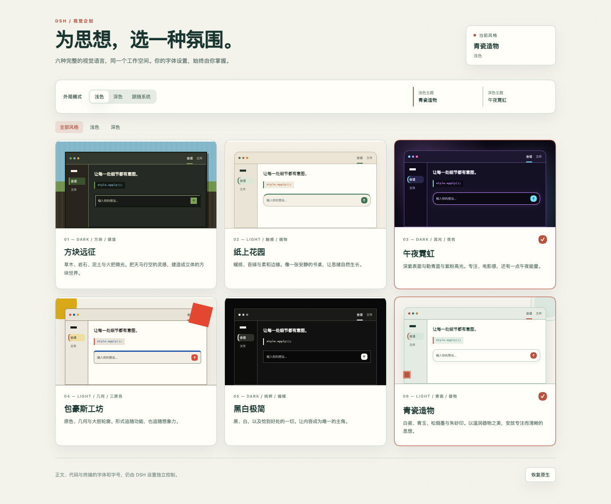
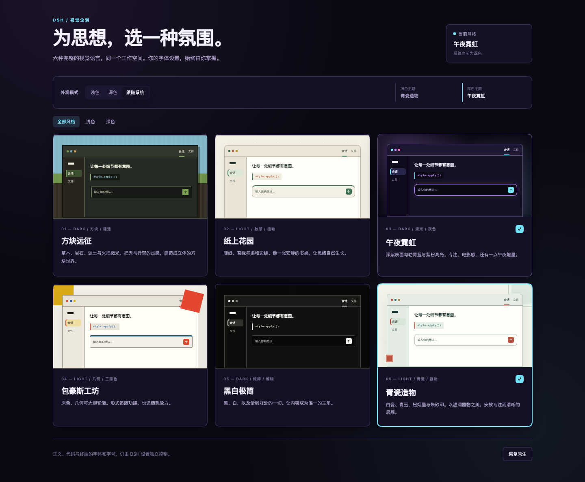

# Atelier · 风格画廊

**给 DeepSeek Harness 换一种工作氛围。**

六套完整视觉风格，独立搭配浅色与深色主题，随系统明暗自动切换。字体与字号继续由 DSH 设置掌管。

[安装](#安装) · [使用指南](docs/USAGE.md) · [版本下载](https://github.com/takboo/dsh-atelier/releases) · [更新记录](CHANGELOG.md) · [反馈问题](https://github.com/takboo/dsh-atelier/issues)



## 一个工作空间，六种氛围

| 风格 | 明暗 | 视觉语言 |
| --- | --- | --- |
| **青瓷造物 · Celadon Studio** | 浅色 | 白瓷、青玉、松烟墨与朱砂印，温润而清晰。 |
| **纸上花园 · Paper Garden** | 浅色 | 暖纸、苔绿与柔和圆角，像一张安静的书桌。 |
| **包豪斯工坊 · Bauhaus Workshop** | 浅色 | 三原色、几何与留白，保留现代印刷的秩序感。 |
| **午夜霓虹 · Midnight Neon** | 深色 | 深紫底色、青蓝与紫粉高光，适合夜间工作。 |
| **方块远征 · Blockrealm** | 深色 | 草木、岩石、泥土与火把微光，带有方块材质与厚度。 |
| **黑白极简 · Mono Study** | 深色 | 高对比黑白、紧凑圆角与克制边框，让内容占据中心。 |

- **全局配色**：统一背景、文字、语义色、圆角、阴影与代码高亮，并为导航、输入区和消息气泡加入风格细节。
- **明暗搭配**：各选一套浅色与深色主题，使用浅色、深色或跟随系统模式。
- **原生阅读习惯**：保留正文、代码与终端的字体和字号，支持中英文界面及减少动态效果偏好。
- **一键恢复**：随时移除自定义风格，回到此前的 DSH 外观设置。



## 安装

需要 **DeepSeek Harness `0.2.1-rc.5`**，支持 Desktop 与 Web GUI。

Atelier 的公开 npm 包、GitHub Release 和 dshmarket 条目正在准备中。首次发布前，可使用下面的源码打包方式安装。

### npm（发布后）

在 DSH 的 **插件 → 添加插件** 中输入：

```text
@takboo/dsh-atelier
```

Web 用户也可以从命令行安装：

```sh
dsh plugin --profile web add @takboo/dsh-atelier
```

启用插件并刷新界面，在左侧打开 **风格画廊**。自定义 profile 请将 `web` 换成实际名称；Desktop 用户直接使用应用内的插件管理器。

### GitHub Release（发布后）

从 [Releases](https://github.com/takboo/dsh-atelier/releases) 下载 `dsh-atelier.tgz`，在 **插件 → 添加插件** 中输入文件的绝对路径，安装并启用。

### dshmarket（收录后）

在 dshmarket 搜索 **Atelier** 或 **风格画廊**，打开详情后安装。

### 从源码打包

需要 Node.js 20+ 和 npm。在仓库根目录运行：

```sh
npm ci
npm pack
```

将生成的 `takboo-dsh-atelier-<版本>.tgz` 的绝对路径填入 DSH 插件安装框。构建会自动完成，使用插件时无需安装开发工具。

## 选好你的明暗搭配

1. 初次点击风格卡片，会立即采用它的明暗模式。
2. 选择 **跟随系统**，再分别点击浅色与深色卡片，保存两种环境的搭配。
3. 手动模式下，点击另一种明暗的卡片会同时切换模式。
4. 点击 **恢复原生**，回到进入 Atelier 前的 DSH 外观偏好。

默认搭配为 **青瓷造物 / 午夜霓虹**。选择保存在当前浏览器中，重新打开仍会沿用。DSH 设置中的字体和字号可以照常调整。

更多操作和常见问题见[使用指南](docs/USAGE.md)。

## 开发与贡献

```sh
npm ci
npm run check
npm run dev
```

欢迎通过 [Issues](https://github.com/takboo/dsh-atelier/issues) 提交问题或风格建议，通过 Pull Request 贡献改进。提交问题时附上 DSH 版本、所选风格、明暗模式和复现步骤。

[开发说明](docs/DEVELOPMENT.md)介绍模块结构、测试和截图维护；[发布指南](docs/RELEASING.md)说明 npm、GitHub Release 与 dshmarket 的发布流程。

## 许可证

[MIT](LICENSE) © takboo
